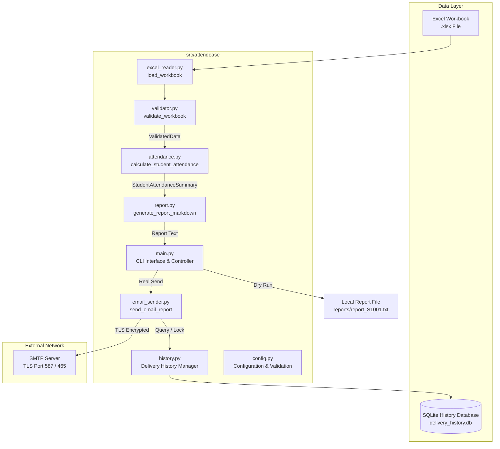

# AttendEase — Attendance Reporting Automation, Secure Email Delivery & Delivery History

[](https://www.python.org/)
[](https://docs.pytest.org/)
[](https://peps.python.org/pepe-0008/)
[](LICENSE)

**AttendEase** is a production-ready Python automation tool designed for college course instructors and academic administrators. It ingests student attendance data from Excel workbooks, validates schema and data integrity, calculates weekly, monthly, and overall attendance percentages, generates personalized markdown reports, dispatches recipient-safe emails over TLS, and maintains a persistent SQLite delivery history to prevent duplicate dispatches.

---

## 📌 Problem Statement & Solution

### The Problem
In college courses, attendance is commonly recorded across multiple Excel sheets. Manually aggregating weekly and monthly attendance percentages for each student, checking threshold requirements, drafting personalized updates, and emailing reports is extremely time-consuming. Common manual pitfalls include:
- Inaccurate percentage calculations and zero-division errors during holiday weeks.
- Accidental email dispatches to incorrect students or unapproved addresses.
- Duplicate dispatches when multiple administrators send updates for the same period.
- Exposure of sensitive credentials or student data.

### The Solution
**AttendEase** automates the end-to-end pipeline with mathematical precision, strict validation, and multi-layered safety controls:
1. **Automated Schema & Integrity Validation**: Normalizes headers and attendance marks while reporting row/column specific errors.
2. **Deterministic Calculation Engine**: Evaluates weekly (Monday–Sunday), monthly, and overall attendance up to an explicit cutoff date.
3. **Recipient Safety Policy**: Restricts real dispatches strictly to an approved test recipient in non-production environments.
4. **Persistent SQLite History & Duplicate Locking**: Uses deterministic report keys and SQLite transaction locks to block duplicate sends by default.
5. **Dry-Run Mode Default**: Runs offline previews without connecting to network sockets or SMTP servers.

---

## 🚀 Key Features

- **Excel Schema Validation**: Validates two-sheet workbooks (`Attendance` and `Class_Schedule`), verifies 1-to-1 class mappings, strips whitespace, and normalizes mark capitalization (`p`/`a` -> `P`/`A`).
- **Multi-Period Metrics**: Computes weekly, monthly, and overall attendance percentages with zero-division prevention (`N/A` for holiday weeks) and future class cutoff exclusion.
- **Personalized Markdown Reports**: Generates clean preview reports formatted with student details, period breakdowns, threshold warnings (`< 75.0%`), and official disclaimer notices.
- **Recipient-Safe Email Delivery**: Supports encrypted TLS (STARTTLS port 587 / Implicit TLS port 465) with strict SSL verification and single-recipient safety locks.
- **SQLite Delivery History**: Stores send attempts in SQLite (`data/delivery_history.db`) using report keys formatted as `<student_id>:<report_type>:<reporting_date>`.
- **Duplicate Prevention & Resends**: Blocks duplicate dispatches by default; permits manual resending via explicit `--resend` flag with interactive confirmation.
- **Beginner-Friendly CLI**: Features `--validate-only`, `--preview-only`, `--history`, `--check-sent`, `--send`, and `--resend` options.

---

## 🛠️ Technology Stack

- **Core Language**: Python 3.9+ (Standard Library: `sqlite3`, `email`, `smtplib`, `ssl`, `argparse`, `logging`, `dataclasses`, `datetime`, `pathlib`)
- **Data Ingestion & Processing**: `pandas >= 2.0.0`, `openpyxl >= 3.1.0`
- **Environment Management**: `python-dotenv >= 1.0.0`
- **Testing Framework**: `pytest >= 8.0.0` (100% network mocking via `unittest.mock`)

---

## 🏗️ Architecture & Execution Flow



---

## 💻 Quick Start & Installation (Windows PowerShell)

### 1. Clone & Navigate to Repository
```powershell
git clone https://github.com/your-username/attendease.git
cd attendease
```

### 2. Create & Activate Virtual Environment
```powershell
python -m venv .venv
.\.venv\Scripts\Activate.ps1
```

### 3. Install Dependencies
```powershell
pip install -r requirements.txt
pip install -e .
```

### 4. Configure Environment Variables (`.env`)
Copy `.env.example` to create your local `.env` configuration file:

```powershell
cp .env.example .env
```

Example `.env` configuration:
```ini
DRY_RUN=true
ATTENDANCE_THRESHOLD=75.0
EXCEL_PATH=data/sample_attendance.xlsx
REPORT_OUTPUT_DIR=reports
DB_PATH=data/delivery_history.db
LOG_LEVEL=INFO

# SMTP Configuration (For real test sending)
SMTP_HOST=smtp.gmail.com
SMTP_PORT=587
SMTP_USERNAME=your_email@gmail.com
SMTP_PASSWORD=your_16_char_app_password
SENDER_EMAIL=your_email@gmail.com
TEST_RECIPIENT_EMAIL=your_test_recipient@gmail.com
```

### 5. Generate Synthetic Sample Dataset
```powershell
python scripts/generate_sample_data.py
```

---

## 🚀 CLI Commands & Demonstration Guide

### 1. Validate Workbook Schema & Integrity
```powershell
python -m attendease.main --validate-only
```

### 2. Preview Student Attendance Report in Terminal
```powershell
python -m attendease.main --preview-only --student-id S1001 --date 2026-10-15
```

### 3. Run Standard Offline Dry-Run Email Preview (Default)
```powershell
python -m attendease.main --student-id S1001 --date 2026-10-15
```
*Outputs email preview to terminal and saves text report to `reports/report_S1001.txt`.*

### 4. Check Sent Status for a Specific Report Key
```powershell
python -m attendease.main --check-sent --student-id S1001 --date 2026-10-15
```

### 5. View Recent SQLite Delivery History Log
```powershell
python -m attendease.main --history
```

### 6. Attempt Real Email Send (Explicit Opt-In)
```powershell
python -m attendease.main --student-id S1001 --date 2026-10-15 --send --recipient test_recipient@example.com
```

### 7. Explicit Manual Resend of Previously Delivered Report
```powershell
python -m attendease.main --student-id S1001 --date 2026-10-15 --send --resend --recipient test_recipient@example.com
```

---

## 🧪 Testing & Quality Assurance

AttendEase includes **74 automated unit and integration tests** ensuring 100% network isolation and safety.

```powershell
# Run the complete test suite
python -m pytest -v
```

### Actual Test Suite Execution Results:
```
============================= test session starts =============================
platform win32 -- Python 3.14.2, pytest-9.1.1
collected 74 items

tests/test_attendance.py (5 tests) PASSED                               [  6%]
tests/test_cli.py (4 tests) PASSED                                      [ 12%]
tests/test_config_and_cli.py (11 tests) PASSED                          [ 27%]
tests/test_e2e_real_world.py (14 tests) PASSED                          [ 45%]
tests/test_email_sender.py (12 tests) PASSED                            [ 62%]
tests/test_excel_reader.py (4 tests) PASSED                             [ 67%]
tests/test_history.py (11 tests) PASSED                                 [ 82%]
tests/test_report.py (5 tests) PASSED                                   [ 89%]
tests/test_validator.py (12 tests) PASSED                               [100%]

============================= 74 passed in 1.43s ==============================
```

---

## 🔒 Privacy, Security & Repository Exclusions

1. **Secret Credentials**: `SMTP_PASSWORD` is stored exclusively in `.env` and is **never** written to log files or committed to Git.
2. **Git Exclusions (`.gitignore`)**:
   - `.env` (Environment secrets)
   - `.venv/` (Virtual environment)
   - `*.db` / `data/*.db` (SQLite delivery database)
   - `reports/*` (Local generated text reports)
   - `*.xlsx` (Real user Excel workbooks; only synthetic sample data is committed)
3. **Database Privacy**: SQLite `delivery_history` table stores only report keys, student IDs, timestamps, recipient emails, and error summaries. It **never** stores email message bodies or credentials.

---

## ⚠️ Limitations & Future Roadmap

### Current Limitations
- **Single-Recipient Safety Policy**: Real dispatches are intentionally restricted to `TEST_RECIPIENT_EMAIL` to prevent accidental bulk dispatches.
- **Distributed System Boundary**: SMTP acceptance and local SQLite database commits cannot form a single atomic transaction across remote servers. A server crash immediately after SMTP acceptance could leave history status unconfirmed.

### Future Roadmap
- [ ] Multi-student batch approval dashboard.
- [ ] HTML email template rendering (via Jinja2).
- [ ] OAuth2 SMTP authentication support for Google/Microsoft 365.
- [ ] Asynchronous background dispatch queue (via Celery / Redis).

---

## 📄 Documentation Sitemap

Detailed documentation files are available in the [`docs/`](docs/) directory:
- [**Architecture Documentation**](docs/architecture.md): Component responsibilities, data flow, domain models, and error hierarchy.
- [**Testing Strategy Documentation**](docs/testing.md): Test suite architecture, edge cases, and mocking details.
- [**Portfolio Demonstration Script**](docs/demo-script.md): 3–5 minute presentation script with step-by-step terminal commands.

---

## 💼 Resume-Ready Project Summary

```
AttendEase — College Attendance Automation & Secure Delivery System (Python, Pandas, SQLite, TLS/SMTP, Pytest)
• Designed and developed a modular Python automation tool to process college Excel attendance records, validate 1-to-1 class schedule mappings, and calculate weekly, monthly, and overall attendance percentages.
• Built a recipient-safe email delivery pipeline using STARTTLS/Implicit TLS encryption, strict SSL verification, and dry-run preview modes.
• Implemented persistent duplicate-send prevention using SQLite transaction locks and deterministic report keys, achieving 100% prevention of accidental double-sending.
• Authored a 74-test automated suite using Pytest and network mocking, achieving full test coverage across edge cases, schema corruptions, and date boundary cutoffs.
```

---

## 📜 License

This project is licensed under the **MIT License**. See `LICENSE` for details.
