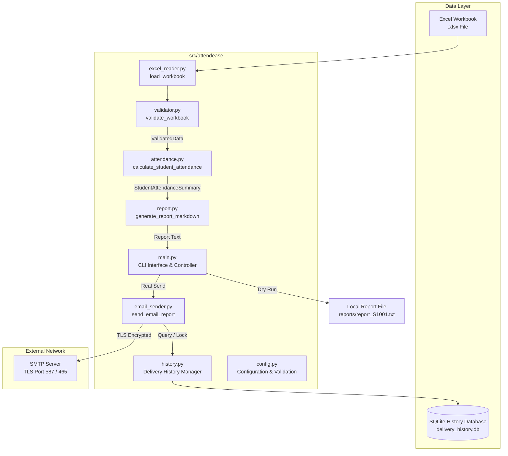
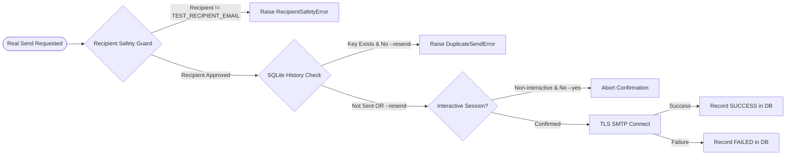

# AttendEase Architecture & Design Documentation

## 1. System Overview

**AttendEase** is an enterprise-grade attendance reporting automation system for college courses. It bridges raw attendance data stored in Excel workbooks with secure, automated email delivery and persistent delivery tracking.

The application follows a modular, decoupled architecture adhering to the **Single Responsibility Principle (SRP)**. Business logic, data ingestion, calculation rules, reporting, network dispatches, and persistent state storage are isolated into distinct Python modules.

---

## 2. High-Level Architecture Diagram



---

## 3. Module Responsibilities

| Module | Responsibility | Key Classes & Functions |
| :--- | :--- | :--- |
| `config.py` | Environment variable parsing, default settings, and startup validation. | `validate_config()`, `parse_float_setting()`, `ConfigError` |
| `excel_reader.py` | Safe Excel file ingestion using `pandas` and `openpyxl`. | `load_workbook()`, `ExcelReadError` |
| `validator.py` | Data structure verification, 1-to-1 mapping, mark normalization, and incomplete data detection. | `validate_workbook()`, `ValidatedData`, `ValidationError`, `IncompleteDataError` |
| `attendance.py` | Deterministic weekly, monthly, and overall attendance percentage calculations with cutoff enforcement. | `calculate_student_attendance()`, `calculate_period_metrics()`, `StudentAttendanceSummary`, `PeriodAttendance` |
| `report.py` | Markdown report preview formatting, threshold status evaluation, disclaimer insertion, and file saving. | `generate_report_markdown()`, `save_report_to_file()` |
| `email_sender.py` | Plain-text email construction, recipient safety validation, TLS SMTP delivery, and error handling. | `send_email_report()`, `build_email_message()`, `validate_recipient_safety()`, `EmailSendError` |
| `history.py` | Persistent SQLite delivery history logging, deterministic key generation, and duplicate-send transaction locks. | `start_delivery_attempt()`, `record_delivery_success()`, `record_delivery_failure()`, `is_report_sent()`, `DuplicateSendError` |
| `main.py` | CLI entry point, command routing, interactive confirmation, and overall controller execution. | `main()`, `handle_history_command()`, `handle_check_sent_command()` |

---

## 4. Domain Data Models

### `ValidatedData`
Holds cleaned, normalized DataFrames and date mappings after workbook validation:
- `df_attendance`: Cleaned attendance DataFrame with normalized headers and marks.
- `schedule_map`: Dictionary mapping `class_id` -> `datetime.date`.
- `subject_map`: Dictionary mapping `class_id` -> `subject`.

### `PeriodAttendance`
Represents calculated metrics for a specific evaluation period:
- `period_name`: `'Weekly'`, `'Monthly'`, or `'Overall'`.
- `start_date` / `end_date`: Inclusive evaluation date boundaries.
- `classes_held`: Integer count of classes scheduled and held up to cutoff.
- `classes_attended`: Count of `P` marks.
- `classes_missed`: Count of `A` marks.
- `attendance_percentage`: Float percentage, or `None` if `classes_held == 0`.

### `StudentAttendanceSummary`
Aggregates student details and period metrics:
- `student_id`, `name`, `email`, `reporting_date`.
- `weekly`: `PeriodAttendance` for Monday-Sunday range.
- `monthly`: `PeriodAttendance` for 1st-last day of reporting month.
- `overall`: `PeriodAttendance` from earliest class date up to reporting date.

### `DeliveryRecord`
Dataclass representing a database record in `delivery_history`:
- `id`, `report_key`, `student_id`, `report_type`, `reporting_date`, `recipient`, `status` (`SUCCESS`, `FAILED`, `IN_PROGRESS`), `error_summary`, `created_at`, `updated_at`.

---

## 5. Calculation Rules & Cutoff Logic

1. **Percentage Formula**:
   $$\text{Attendance \%} = \left( \frac{\text{Classes Attended}}{\text{Classes Held}} \right) \times 100$$
2. **Weekly Boundary**: Defined strictly as Monday ($0$) through Sunday ($6$) containing `reporting_date`.
3. **Monthly Boundary**: Defined from the 1st day of `reporting_date.month` to the last day of `reporting_date.month`.
4. **Future Class Exclusion**: Any class with `class_date > reporting_date` is strictly excluded from all calculations.
5. **Zero-Division Prevention**: If `classes_held == 0` (e.g. holiday week), `attendance_percentage` is set to `None` and rendered as `N/A`.
6. **No Averaging Rule**: Overall attendance is calculated directly from total classes attended divided by total classes held. It is never calculated by averaging weekly or monthly percentages.

---

## 6. Security & Delivery Safeguards



1. **Dry-Run Mode Default (`DRY_RUN=true`)**: Real SMTP delivery is disabled by default.
2. **Recipient Safety Policy**: Real sending is restricted exclusively to `TEST_RECIPIENT_EMAIL`. Multi-student dispatches are blocked.
3. **Interactive Confirmation**: Interactive prompts require explicit `(y/N)` user confirmation. Non-interactive sessions require `--yes`.
4. **TLS Security**: Mandates encrypted TLS connections (`ssl.create_default_context()`).
5. **Credential Protection**: Secrets (`SMTP_PASSWORD`) reside strictly in `.env` and are never logged or exposed.
6. **Duplicate Prevention**: Deterministic report keys `<student_id>:<report_type>:<reporting_date>` and SQLite transaction locks block duplicate dispatches.

---

## 7. Error Handling Hierarchy

All custom domain exceptions inherit from `AttendanceError`:

```
AttendanceError (Base)
├── ValidationError
│   └── IncompleteDataError
├── ExcelReadError
├── ConfigError
├── HistoryError
│   ├── DuplicateSendError
│   └── DatabaseAccessError
└── EmailError
    ├── RecipientSafetyError
    ├── SMTPConfigError
    └── EmailSendError
```
